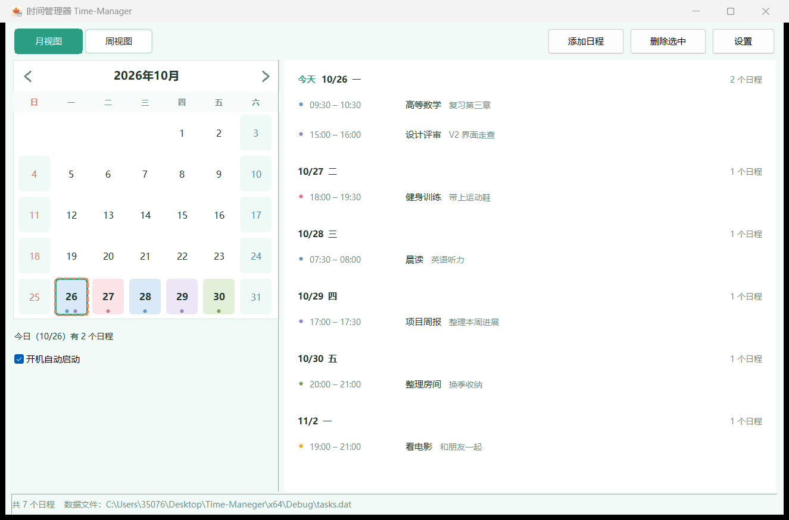
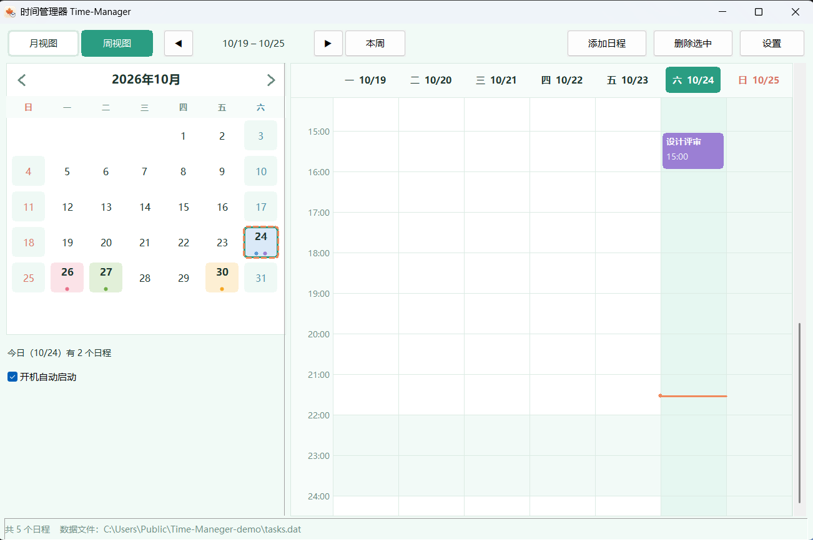
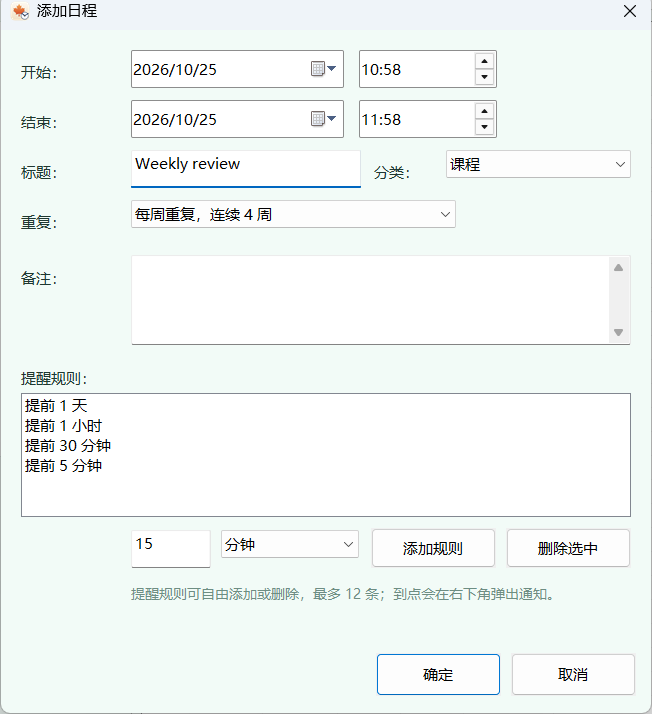
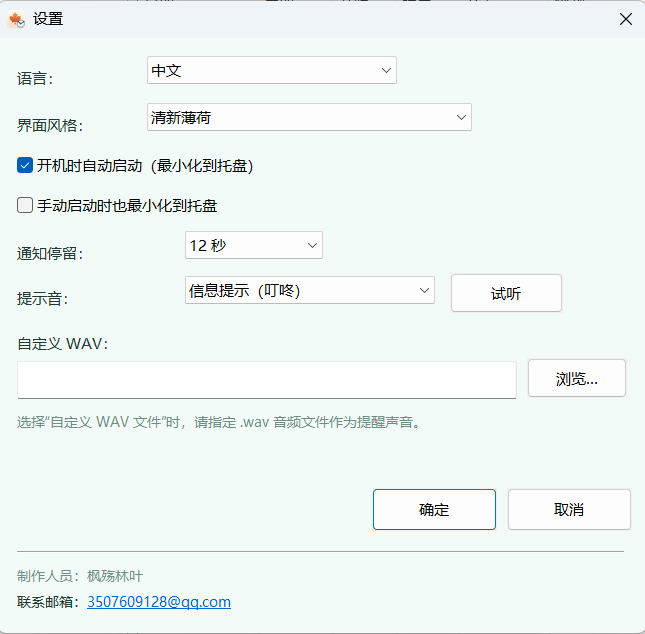
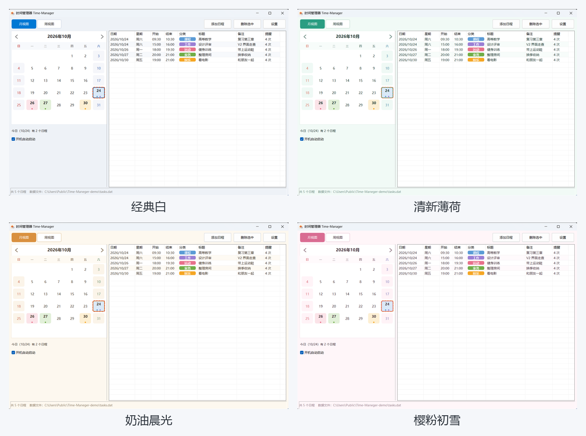

# 时间管理器 · Time-Manager

<p align="center">
  
</p>

一个轻量的 Windows 桌面日程提醒工具，使用纯 Win32 API + C++ 编写，无第三方运行时依赖。支持日历视图、周视图、分钟级日程、单次或连续多周日程、自定义提醒、仿 Windows 11 的 Toast 通知、托盘常驻与开机自启，并提供中文 / 日本語 / English 三种界面语言和四套可切换的界面风格。







## 功能

- **简洁双栏布局**：左侧大日历、右侧按日期分组的活动流，顶部可在“月视图 / 周视图”之间切换
- **月视图**：今天的日期用橙色虚线框标出，有日程的日期按分类显示醒目底色；月历按当月实际 4–6 周自适应行高，5 周月份不再留底部空行；点击日期筛选当天日程（再次点击取消筛选），支持箭头、滚轮和键盘切换月份
- **周视图**：以课表式时间轴展示一周活动（周一至周日、7:00–23:00 可滚动），不同分类用彩色圆角方块；时间重叠的活动自动分栏并排，今天所在列高亮，并显示红色当前时间线；可上/下翻周、一键回到本周
- **分组活动流**：月视图右侧按日期分组，分组标题显示日期和当天日程数（今天高亮）；每条日程一行展示时间段、分类色点、标题与备注，去掉表头与网格线，长标题/备注自动省略；分类、提醒次数等完整信息可在悬停气泡中查看
- **活动分类**：新建日程时可选择 课程 / 家务 / 工作 / 运动 / 娱乐 / 其他 六类，每类固定一种颜色，在日历、周视图方块和活动流中统一呈现
- **悬停看细节**：鼠标悬停月历日期可查看当天全部日程（时间 + 标题），悬停周视图彩色方块可查看该活动的分类、起止时间与备注，悬停活动流中的日程可查看分类、时间与提醒次数
- **日程管理**：任意日期，开始/结束时间精确到分钟，可填写标题、分类与备注
- **单次 / 连续多周日程**：新增日程时可选择“单次日程”或“每周重复，连续 2–20 周（含开始周）”；程序会为每一周生成一条独立日程，日期、分类、提醒规则保持一致，可分别查看、删除和提醒
- **批量选择 / 删除**：月视图活动流中按住 Ctrl 点选多条（Shift 连选），按钮会显示已选数量，点“删除选中”一次删除全部选中日程；支持 Ctrl+A 全选、Esc 取消选择；周视图仍支持单条删除
- **自定义提醒**：每条日程最多 12 条提醒规则，可提前 N 分钟 / 小时 / 天，自由添加与删除
- **Toast 通知**：到点从屏幕右下角滑入，仿系统通知样式，支持多条堆叠、悬停暂停、点击打开主窗口
- **提示音**：系统提示音、简单蜂鸣，或自定义 `.wav` 文件
- **托盘常驻**：关闭窗口自动最小化到托盘，后台继续提醒；托盘菜单可恢复或退出
- **开机自启**：写入当前用户注册表 `HKCU\...\Run`，可选择启动时最小化
- **多语言**：设置中可切换中文 / 日本語 / English，点“确定”后立即生效
- **界面风格**：内置 经典白 / 清新薄荷 / 奶油晨光 / 樱粉初雪 四套主题，设置中切换后立即应用并保存；默认使用“清新薄荷”
- **本地数据**：`tasks.dat` / `settings.dat` 保存在 exe 同目录，UTF-8 编码，不联网、无遥测





## 环境要求

- Windows 10 / 11 x64
- Visual Studio 2026，安装“使用 C++ 的桌面开发”工作负载
- Windows 10/11 SDK
- 项目当前使用 **v145** 平台工具集（VS 2026）

## 构建

1. 打开 `Time-Maneger.slnx`
2. 选择 `x64` 和 `Release`
3. 生成解决方案

输出文件：

```
x64\Release\Time-Maneger.exe
```

也可以在 Visual Studio 的 Developer PowerShell 中执行：

```powershell
msbuild Time-Maneger.vcxproj /p:Configuration=Release /p:Platform=x64
```

## 使用

1. 把 `Time-Maneger.exe` 放到一个有写入权限的文件夹（**不要放在 `C:\Program Files`**，程序需要在该目录创建数据文件）
2. 首次运行会自动生成 `tasks.dat` 和 `settings.dat`
3. 点“添加日程”填写日期、时间、标题、备注和提醒规则；如需连续几周，在“重复”中选择“每周重复，连续 N 周”
4. 点“设置”可以修改语言、界面风格、通知停留时间、提示音、开机自启等
5. 点窗口关闭按钮会最小化到托盘；双击托盘图标恢复，右键可退出

## 数据与隐私

- 所有日程和设置只保存在本机 exe 同目录，不会上传到任何服务器
- 备份：复制 `tasks.dat` 和 `settings.dat` 即可
- 清空日程：关闭程序后删除 `tasks.dat`
- 恢复默认设置：关闭程序后删除 `settings.dat`
- 程序只会在你开启“开机自启”时写入注册表，不会修改系统其他位置

## 项目结构

```
main.cpp                  主程序（Win32、GDI、多语言、日历、通知）
app.rc                    资源脚本
app.ico                   应用图标（16–256 多尺寸）
resource.h                资源 ID
Time-Maneger.vcxproj      Visual Studio 工程
Time-Maneger.slnx         解决方案
docs/                     README 使用的图标与截图
```

## 制作人员

- 作者：枫殇林叶
- 邮箱：3507609128@qq.com
- 应用图标由作者为该项目绘制

## English

A lightweight Windows schedule reminder written in C++ with the Win32 API. It offers a clean two-pane layout — a month view with a date-grouped agenda on the right, plus a week view (timetable-style time axis with color-coded blocks, overlapping-event lanes, today-column highlight and a current-time line) — six event categories (Course / Chores / Work / Sport / Leisure / Other) with their own colors, hover tooltips with full event details, single or weekly recurring events (up to 20 consecutive weeks), today/task highlighting, minute-precise events, customizable reminder rules, Windows 11-style toast notifications, tray support, autostart, a Chinese / Japanese / English UI, and four switchable color themes (Classic, Fresh Mint, Cream Morning, Sakura).

Requires Windows 10/11 x64 and Visual Studio 2026 (v145 toolset). Open `Time-Maneger.slnx`, build `x64/Release`, and run `Time-Maneger.exe`. All data is stored locally next to the executable.

## License

[MIT](LICENSE)
